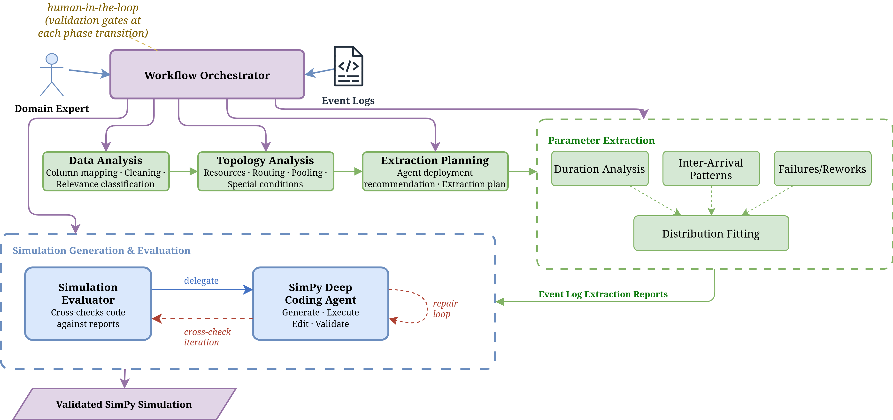

# GenAI4SimPy — Deep Agents

> **Automatically generate executable [SimPy](https://simpy.readthedocs.io/) discrete-event simulation models from manufacturing event logs using a multi-agent LLM pipeline.**

---

## Overview

`genai4simpy-deepagents` orchestrates a pipeline of specialised AI agents that take a raw production event log (CSV) and — through data analysis, topology analysis, parameter extraction, and code generation — produce a validated, runnable SimPy simulation.

The system is built on the **[DeepAgents](https://github.com/RaikoPipe/deepagents)** framework for hierarchical agent orchestration and **LangGraph** for the SimPy code-generation workflow. Inference is designed to run against open-weight models (for instance served via Ollama).

---

## Research Context

GenAI4SimPy originated as the reference implementation for a peer-reviewed research project on GenAI-driven, privacy-preserving discrete-event simulation generation for small and medium-sized enterprises (SMEs). It is developed at Otto von Guericke University Magdeburg (OVGU) — AI Applications in Production and Logistics (AIPAL) group — together with Hochschule Bielefeld (HSBI) and Anhalt University of Applied Sciences.

**Primary publication:**

> R. Reider, L. Döring, S. Lang, T. Reggelin, S. Trojahn, and P. Reusch. "From Manufacturing Event Logs to Simulation: Enabling SMEs with Agentic AI for SimPy Simulation Generation." *Proceedings of the 2026 Winter Simulation Conference (WSC)*, V. Ramamohan, A. Djanatliev, M. Fakhimi, C. Krejci, C. Ruiz Martin, B. S. Onggo, and N. Mustafee, eds.

The paper introduces GenAI4SimPy as a multi-agent framework that is powered by a local, open-weight LLM (Qwen 3.6, 27B, served via Ollama). The framework automates end-to-end DES generation from raw manufacturing event logs to executable SimPy models, using tool-augmented reasoning and human-in-the-loop (HITL) validation gates. It was evaluated on three execution blocks of the public Fischertechnik Smart Factory event log (Malburg, Grüger, & Bergmann, 2022).

If you use this framework in academic work, please cite the WSC paper:

```bibtex
@inproceedings{reider2026genai4simpy,
  title     = {From Manufacturing Event Logs to Simulation: Enabling SMEs with Agentic AI for SimPy Simulation Generation},
  author    = {Reider, Richard and D{\"o}ring, Lina and Lang, Sebastian and Reggelin, Tobias and Trojahn, Sebastian and Reusch, Pascal},
  booktitle = {Proceedings of the 2026 Winter Simulation Conference (WSC)},
  editor    = {Ramamohan, V. and Djanatliev, A. and Fakhimi, M. and Krejci, C. and Ruiz Martin, C. and Onggo, B. S. and Mustafee, N.},
  year      = {2026}
}
```

---

## Architecture

### Three-Agent Pipeline



Each sub-agent has **role-based report access** — it can only read the reports it needs and write the report it owns. The orchestrator checks for existing reports on startup and **skips completed phases**, allowing interrupted runs to resume.

## Features

- **End-to-end automation** — from raw CSV to validated simulation code
- **Phase resumption** — skip already-completed analysis phases
- **Statistical distribution fitting** — tests 7 scipy distributions and picks the best fit (KS test)
- **Embedded SimPy knowledge** — API reference always loaded; examples/guides retrieved via semantic search
- **Self-hosted LLM** — runs fully locally via Ollama (no API keys required)
- **Role-based agent access control** — prevents agents from accessing or overwriting irrelevant reports
- **Structured code editing** — LLM produces `str_replace` diffs rather than full rewrites

---

## Project Structure

```
genai4simpy-deepagents/
├── agent.py                            # Entry point — orchestrator setup
├── pyproject.toml
├── langgraph.json                      # LangServe deployment config
│
├── data/
│   └── production_data/
│       └── Production_Data.csv         # Input event log
│
├── reports/                            # Agent outputs (auto-generated)
│   ├── column_mapping_report.md
│   └── parameter_extraction_report.md
│
└── src/
    ├── genai4simpy_agent/
    │   ├── prompts.py                  # System instructions for all agents
    │   └── tools.py                   # Report read/write/check tools
    │
    ├── data_extraction_tools/
    │   └── tools.py                   # Dataset exploration & statistics tools
    │
    └── simpy_code_workflow/
        ├── graph.py                   # LangGraph code-generation workflow
        ├── tool.py                    # Tool wrapper for orchestrator
        ├── prompts/                   # Prompt files (Markdown)
        ├── context_engineering/       # Vectorstore + SimPy docs
        └── data_models/
            └── simple_model.py        # Pydantic schemas for simulation config
```

---

## Requirements

- Python **3.11+**
- Access to an LLM hosting service (either self hosted or via cloud)

---

## Installation

```bash
git clone <repo-url>
cd genai4simpy-deepagents

# Standard install
pip install -e .

# With dev tools (mypy, ruff, pytest)
pip install -e ".[dev]"
```

---

## Usage

### Run the full pipeline

```bash
python agent.py
```

The pipeline will:
1. Convert `data/production_data/Production_Data.csv` → `data/eventlog.parquet`
2. Check for existing phase reports and skip completed phases
3. **Phase 1** — Analyse the dataset, detect column roles, ask for user confirmation, write `reports/column_mapping_report.md`
4. **Phase 2** — Extract processing times, inter-arrival distributions, routing patterns, write `reports/parameter_extraction_report.md`
5. **Phase 3** — Generate, validate, and repair a SimPy simulation and return the code

### Deploy via LangServe

```bash
langgraph up
```

Exposes two endpoints:
- `http://localhost:8000/agent/` — Full orchestrator
- `http://localhost:8000/simpy_code_agent/` — SimPy code agent only

---

## Experiments & Evaluation

This repository ships the full experimental harness used in the WSC paper: an **experiment runner** that drives the agent pipeline end-to-end and archives every artifact, and a **standalone evaluation harness** that scores any resulting model against ground truth over multiple stochastic replications.

> Note: 3.14 currently crashes the SimPy code agent due to some Python related introspection behavior change.

### 1. Run an experiment (`experiment.py`)

`experiment.py` wraps the orchestrator for reproducible, unattended runs: it loads a CSV event log plus a fixed manufacturing-system context, drives the pipeline to completion (or until the phase-recovery budget is exhausted), and writes every intermediate report, generated model, and timing metric to a uniquely named run directory under `output/<dataset-name>/<run-name>/`.

```bash
python experiment.py \
  -d data/fischertechnik_lab_A/block-A.csv \
  -n 1 \
  --context-file data/fischertechnik_lab_A/user_context.md   # -m <served model> optional
```

| Flag | Description |
|---|---|
| `-d`, `--data-path` | Path to the input event-log CSV |
| `-n`, `--num-replications` | Number of end-to-end pipeline runs to execute |
| `-m`, `--model-name` | Ollama/OpenAI-compatible model tag to use for orchestration |
| `--context-file` | File whose contents seed the manufacturing-system context (see below); mutually exclusive with `--context` |

The three Fischertechnik blocks evaluated in the paper can be reproduced with:

```bash
python experiment.py -d data/fischertechnik_lab_A/block-A.csv -n 1 -m qwen3.6:27b-bf16 --context-file data/fischertechnik_lab_A/user_context.md
python experiment.py -d data/fischertechnik_lab_B/block-B.csv -n 1 -m qwen3.6:27b-bf16 --context-file data/fischertechnik_lab_B/user_context.md
python experiment.py -d data/fischertechnik_lab_C/block-C.csv -n 1 -m qwen3.6:27b-bf16 --context-file data/fischertechnik_lab_C/user_context.md
```

Each run produces:

```
output/<dataset-name>/<run-name>/
├── reports/                          # Phase reports (column mapping, topology, extraction, evaluation, ...)
│   └── simulation/simulation.py      # Generated SimPy model (evaluate.py --model target)
├── work_files/                       # Intermediate parquet/CSV artifacts (cleaned log, fitted params, KDE tables)
└── experiment_results/
    ├── run_info.json                 # Status, timing, model name, run metadata
    └── terminal.log                  # Full mirrored console log
```

Every replication is additionally appended to `results/runs.jsonl` as a single-line JSON record, so multiple experiment invocations accumulate into one cross-run log.

**`data/<dataset>/`** holds the three benchmark blocks (`block-A.csv` / `block-B.csv` / `block-C.csv`, drawn from the public Fischertechnik Smart Factory event log; Malburg et al., 2022), each paired with:
- `user_context.md` — the fixed calibration context compiled from an initial HITL pilot run (data-interpretation clarifications only; see paper Sec. 4), reused for the reproducible autonomous run
- `ground_truth_block_*.py` — empirical ground-truth KPIs and distributions extracted independently from the raw log, consumed by `evaluate.py`
- `og_conversation.md` — the original HITL pilot transcript the context file was distilled from

### 2. Score a generated model (`evaluate.py`)

`evaluate.py` is a model-agnostic evaluation harness (Stage 2 of the paper's methodology). It takes **any** generated SimPy module satisfying the [Model Output Contract](#model-output-contract) below plus a ground-truth file, runs `m` independent stochastic replications, and reports KPI point estimates, confidence intervals, coverage/threshold verdicts, and an aggregated quality score.

```bash
python evaluate.py \
  --model output/fischertechnik_lab_A/<run-name>/reports/simulation/simulation.py \
  --ground-truth data/fischertechnik_lab_A/ground_truth_block_A.py \
  -n 30
```

| Flag | Description |
|---|---|
| `--model` | Path to the generated model `.py` (must satisfy the output contract) |
| `--ground-truth` | Path to the corresponding `ground_truth_block_*.py` (or `.json`) |
| `-n`, `--replications` | Number of independent replications (paper uses `m = 30`) |
| `--seed` | Base seed for reproducible replications (default `42`) |
| `--sim-time` | Override simulation horizon in seconds (defaults to the ground truth's observation window) |
| `-o`, `--output` | Output directory (default `output/evaluation`) |

KPIs are split into two families, matching Figure 2 of the paper:
- **Coverage-based** (throughput, mean flow time, failure rate) — pass when the KPI's 95% CI crosses zero deviation from ground truth.
- **Threshold-based** (activity-duration MAPE ≤ 20%, variant-routing Jensen–Shannon divergence ≤ 0.05) — pass when the CI stays under the threshold.

Results are written to `<output>/evaluation_results.json` (full KPI/CI/verdict/quality-score breakdown) and `<output>/replication_kpis.csv` (one row per replication).

### 3. Reproduce the paper's forest plots (`forest_plot.py`)

```bash
python forest_plot.py
```

Renders the per-block confidence-interval forest plots (coverage KPIs and threshold KPIs) shown as Figure 2 in the WSC paper, saved to `forest_plot_v3.png` / `forest_plot_v3.pdf`. The per-block KPI values are currently hardcoded from the paper's results at the top of the script — update them there to plot a new evaluation run.

### 4. Window-consistent re-evaluation (`evaluate_v2.py`)

`evaluate_v2.py` fixes several shortcomings of `evaluate.py`. It computes ground truth straight from the raw block CSV, using the **same** KPI function that it applies to the simulated log, so it needs no hand-written `ground_truth_block_*.py` constants. KPI bases are the same for every block: completed cases (a successful `/hbw/store` inside the window) and cases entered. Verdicts use a 95% **prediction interval** over per-replication KPIs, the GT percentile rank, bias and the median per-replication error; the CI of the mean is kept for reference only. Activity MAPE runs over all GT activities, and any activity a model is missing scores 100%. The output also includes a flow-time decomposition (service union / overlap / idle) and idle time per resource class. If you pass several `--models` (runs for one block), it also reports a between-run PI over the run means.

```bash
python evaluate_v2.py \
  --models output/fischertechnik_lab_C/<run-name>/reports/simulation/simulation.py \
  --block-csv data/fischertechnik_lab_C/block-C.csv \
  -m 1000 -o eval_v2_out
```

Results are written to `<output>/evaluation_v2.json` and `<output>/replications_v2.csv`.

### 5. Follow-up analyses (`analysis/`)

These scripts reproduce the re-analysis of the three paper models. The model run names are set in `analysis/_common.py`. Each script writes its output to the current working directory. You set the replication count with an environment variable.

| Script | Purpose | Output |
|---|---|---|
| `analysis/reeval.py` (`M_REPS`, default 500) | Compares the published `evaluate.py` harness with unified, window-consistent KPI definitions (PI + GT percentile) | `reeval_A2_A5.csv`, `reeval_meta.json`, `reps_*.csv` |
| `analysis/counterfactual.py` (`M`, default 300) | Swaps FIFO hbw resources for priority resources, where in-process cases go ahead of new `/hbw/unload` orders | `counterfactual_hbw_priority.json` |
| `analysis/crossblock.py` (`M`, default 300) | Hold-out test: every model scored on every block, in both arms, against a "copy source statistics" baseline | `crossblock_A1.csv` |
| `analysis/probe.py` | Diagnostics: hbw/vgr usage, unload spacing, utilisation and pre-activity gaps, real vs. simulated | stdout |

```bash
M=300 python analysis/counterfactual.py
```

---

## Configuration

The model is served by any OpenAI-compatible server. `scripts/vllm_qwen38.sbatch` starts vLLM
(Qwen3.8-27B; BF16 on ≥70 GB GPUs, AWQ-INT4 otherwise; MTP speculative decoding) and writes
`logs/vllm_endpoint.env`, which `agent.py` reads. `LLM_BASE_URL` / `LLM_API_KEY` override it.

| Variable | Default | Meaning |
|---|---|---|
| `CODEGEN_MODE` | `compiler` | `compiler`: simulation.py is compiled from the spec (`src/genai4simpy_agent/compiler.py`); `llm`: the coding agent writes it |
| `LLM_TEMPERATURE` / `LLM_TOP_P` / `LLM_TOP_K` | 0.6 / 0.95 / 20 | sampling (Qwen thinking-mode defaults) |
| `LLM_MAX_TOKENS` | 49152 | output cap per call (truncated calls are re-issued once with a steering note) |
| `LLM_THINKING_BUDGET` | 8192 | vLLM `thinking_token_budget` per call |
| `CONTEXT_CLEAR_TRIGGER` | 40000 | sub-agents clear older tool results above this many tokens |
| `RUN_PYTHON_LIMIT` | 8 | `run_python` calls per sub-agent invocation |

`experiment.py --resume-run <run-name>` continues an existing run directory (completed phases are skipped).
`scripts/run_llm_experiments.sh [compiler|llm] A B C` runs blocks in parallel (`RESUME_<B>=<run>` to resume).

### Pipeline artefacts (per run)
- `reports/simulation_spec.json` — typed spec (single source of truth for all numbers) and its generated view `simulation_spec.md`
- `reports/evidence/*.json` — full results of the deterministic tools (provenance)
- `reports/hitl_log.jsonl` — every question answered without the user, with answer, source and category
- `experiment_results/tool_calls.jsonl`, `telemetry*.json` — untruncated tool I/O, tokens, latency, retries, guard events

### Deterministic tools added
- Discovery (`src/data_extraction_tools/discovery.py`, `routing.py`): `set_log_schema`, `detect_censoring`,
  `discover_variant_routings`, `test_dispatching_rules`, `decompose_waiting_times`, `detect_release_control`,
  `detect_intra_case_concurrency`
- Spec (`src/genai4simpy_agent/spec.py`, `spec_drafting.py`): `read_spec`, `write_spec_section` (validated, merge),
  `draft_topology_spec`, `draft_activities_spec`, `draft_arrivals_spec`, `check_spec_against_evidence`
- Verification (`src/genai4simpy_agent/verification.py`): `run_contract_test` (contract v2), `run_behavioural_check`
  (training-window KPIs, distances, deterministic verdict), `run_metamorphic_tests`
- References: `analysis/deterministic_baseline.py` (LLM-free spec → compiler), `analysis/compare_runs.py`,
  `analysis/mutation_test.py`

## Tech Stack

| Category            | Library                                |
| ------------------- | -------------------------------------- |
| Agent orchestration | `deepagents`, `langchain`, `langgraph` |
| LLM backend         | `langchain-ollama`                     |
| Data processing     | `pandas`, `numpy`, `scipy`             |
| Vector search       | `chromadb`, `sentence-transformers`    |
| Data validation     | `pydantic`                             |
| Logging             | `loguru`                               |
| Linting             | `ruff`                                 |

---

## License

MIT — see [LICENSE](LICENSE).

---

## Author

Richard Reider — richard@reider.io

---
